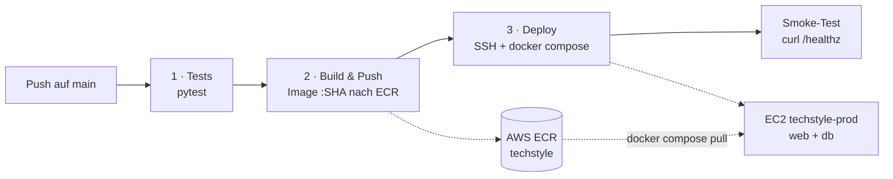

# Deployment — TechStyle auf AWS (ECR + EC2)

## Ausgangsstand

Diese Musterlösung baut auf `day_13_solution` auf: Flask-Shop mit Gunicorn im Service `web`, PostgreSQL im Service `db`, Daten im Volume `postgres-data`. Ein Team, das mit seinem eigenen Projekt arbeitet, nennt hier seinen Team-Repository-Branch und die Abweichungen (Port, Healthcheck-Pfad, Testbefehl).

## Pipeline-Architektur



| Stufe | Job | Was passiert |
|-------|-----|--------------|
| 1 | `test` | Installiert `requirements-container.txt` und führt `pytest` aus. Rote Tests stoppen die Pipeline. |
| 2 | `build-push` | Meldet sich mit den Learner-Lab-Credentials bei AWS und ECR an, baut das Image aus dem `Dockerfile` und pusht es als `techstyle:<commit-sha>` und `techstyle:latest`. |
| 3 | `deploy` | Kopiert `docker-compose.prod.yml` und eine `.env` per SSH auf die EC2-Instanz, meldet Docker dort bei ECR an, zieht das neue Image und startet den Stack mit `docker compose up -d --wait`. Danach prüft `curl` den Endpunkt `/healthz` über das Internet. |

Der Server baut nichts selbst. Er startet genau das Image, das in Stufe 1 getestet und in Stufe 2 gebaut wurde. Der Commit-SHA im Tag zeigt jederzeit, welcher Code läuft.

## Infrastruktur

- **ECR-Repository** `techstyle` in `us-east-1`, privat.
- **EC2-Instanz** `techstyle-prod`: Ubuntu Server 24.04 LTS, `t3.small`, Key Pair `vockey`, Security Group mit Port 22 und 80. Docker und Compose installiert [`scripts/ec2-user-data.sh`](scripts/ec2-user-data.sh) beim ersten Start.
- **GitHub Secrets**: `AWS_ACCESS_KEY_ID`, `AWS_SECRET_ACCESS_KEY`, `AWS_SESSION_TOKEN`, `EC2_HOST`, `EC2_SSH_KEY`, `POSTGRES_PASSWORD`, `SECRET_KEY`. Kein Wert liegt im Repository.

## Bedienungsanleitung für Entwickler

**Deployen:** Änderung auf `main` pushen oder mergen. Im Tab **Actions** den Lauf «Tag 14 - Deployment auf AWS» verfolgen. Ist er grün, läuft die neue Version unter `http://<EC2_HOST>`.

**Manuell auslösen:** Actions → «Tag 14 - Deployment auf AWS» → **Run workflow**.

**Neue Lab-Session:** Learner-Lab-Credentials laufen mit der Session ab. Vor dem nächsten Deployment `AWS_ACCESS_KEY_ID`, `AWS_SECRET_ACCESS_KEY` und `AWS_SESSION_TOKEN` neu setzen. Hat die Instanz eine neue öffentliche IP, `EC2_HOST` anpassen. `POSTGRES_PASSWORD` nie ändern: Das Datenbank-Volume behält das Passwort vom ersten Start.

**Logs und Status prüfen:**

```bash
ssh -i labsuser.pem ubuntu@<EC2_HOST>
cd ~/techstyle
docker compose ps
docker compose logs --tail 50 web
```

**Rollback:** Im Tab **Actions** den Lauf eines früheren, funktionierenden Commits öffnen und **Re-run all jobs** wählen. Die Pipeline deployt dann wieder das Image mit dem SHA dieses Commits. Alternativ auf dem Server in `~/techstyle/.env` `TECHSTYLE_IMAGE` auf einen älteren Tag setzen und `docker compose up -d` ausführen.

## Nachweise

- Workflowlauf: `https://github.com/<owner>/<repo>/actions/runs/<run-id>`
- Image: `<account-id>.dkr.ecr.us-east-1.amazonaws.com/techstyle:<commit-sha>`
- Shop: `http://<EC2_HOST>`
- Zweites Deployment: Text auf der Startseite geändert, gepusht, nach dem Lauf im Browser sichtbar.

## Grenzen und Ausblick

Die Lösung ist ein Übungsaufbau. SSH ist für alle IP-Adressen offen, weil die GitHub-Runner wechselnde Adressen haben; besser wären AWS Systems Manager, ein self-hosted Runner oder OIDC statt statischer Schlüssel. Es gibt nur einen Server, deshalb ist der Shop während `docker compose up` kurz nicht erreichbar. Mit **AWS ECS** würde ein Orchestrator die Container auf mehrere Instanzen verteilen, neue Tasks erst nach bestandenem Healthcheck in Betrieb nehmen und alte danach stoppen. Die Pipeline würde dann statt SSH die Task Definition mit dem neuen Image aktualisieren.
