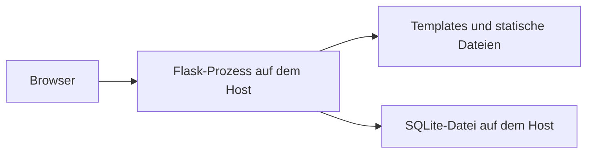
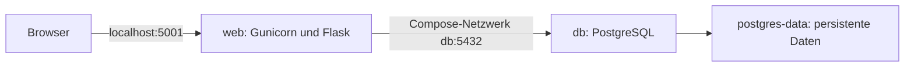
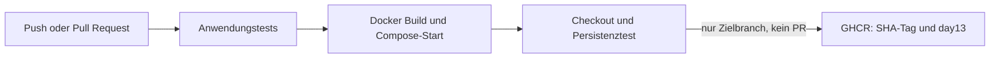

# Tag 13 – Container-Musterlösung für TechStyle

## Einordnung im Unterricht

Du bearbeitest den Projektauftrag in Deinem eigenen Team-Repository, das Ihr an Tag01 angelegt und seither weiterentwickelt habt. Ausgangspunkt ist Euer aktueller Projektstand. Dieses Repository und die Branches `day_xx_solution` enthalten Musterlösungen. Sie dienen zum Vergleichen, als Hilfe und jederzeit als optionale Wiedereinstiegspunkte, falls Euer Projekt nicht funktioniert. `day_12_solution` ist die Musterlösung zu Tag12 und kein verpflichtender Startstand für Tag13.

Sichere Eure bisherigen Änderungen, bevor Ihr einen Musterlösungsstand übernehmt, und dokumentiere den gewählten Wiedereinstieg. Arbeite anschliessend im eigenen Repository weiter. Übertrage einzelne Anpassungen gezielt und erhalte eigene Erweiterungen. Der unten gezeigte Clone-Befehl dient dazu, die vollständige Referenzlösung separat auszuprobieren.

## Ergebnis und Abgrenzung

Der Shop läuft mit Gunicorn in `web` und verwendet tatsächlich PostgreSQL im Service `db`. Compose verbindet beide über den DNS-Namen `db`; die Daten bleiben im benannten Volume `postgres-data`. GitHub Actions baut und testet die Container und veröffentlicht das Anwendungsimage erst nach erfolgreichen Tests in GHCR.

Die Anwendung bleibt ein Monolith. Ein Webcontainer plus Datenbankcontainer ist eine technische Trennung von Laufzeit und Datenhaltung, keine Zerlegung in fachliche Microservices. Die frühere SQLite-Datei ist kein Datenbankserver und lässt sich nicht einfach als eigener SQL-Service starten. Deshalb umfasst diese Lösung einen ausdrücklich ausgewiesenen Backendwechsel über SQLAlchemy und Psycopg. Ohne `DATABASE_URL` bleibt SQLite für die lokale Entwicklung verfügbar. Bestehende SQLite-Daten werden nicht automatisch migriert; der Übungsstack erhält Beispieldaten.

Für eine erste Containerlektion empfiehlt sich zunächst die Variante «bestehende Anwendung und SQLite-Datei in einem persistenten Volume». Den hier umgesetzten Zweicontainer-Stack kannst Du anschliessend anhand des vorbereiteten Datenbankzugriffs bearbeiten. Eine eigenständige Datenbankmigration passt nicht zusätzlich in 45 Minuten für Containeranfänger.

## Auftrag 1 – Analyse und Architektur

`app.py` enthält Produktkatalog, Warenkorb, Checkout, Anmeldung, Administration und HTTP-API. Jinja-Templates und statische Dateien gehören zur gleichen Anwendung. `seed_data.py` liefert 20 Beispielprodukte. SQLite war zuvor unter `/tmp/techstyle.db` fest eingebaut. Es gibt keinen fachlich unabhängigen Produkt- oder Bestellservice mit eigenem API-Vertrag.

Vorher:



Nachher:



Katalog, Bestellung oder Benutzerverwaltung wären mögliche spätere fachliche Grenzen. Eine Ausgliederung verlangt aber eigene Verantwortlichkeiten, Schnittstellen, Datenhoheit und Tests. Für Tag 13 genügt die Containerisierung des bestehenden Shops. Ein zusätzlicher Frontendcontainer hätte bei serverseitigen Jinja-Templates aktuell keinen Lernnutzen.

## Auftrag 2 – Lokal starten

Voraussetzungen: Git, Linux-Container mit Docker Engine bzw. Docker Desktop, Docker Compose v2 mit `--wait`, Internet für Images und Abhängigkeiten; Port 5001 frei. AWS wird nicht benötigt.

```bash
git clone --branch day_13_solution https://github.com/tbzdevops/techstyle.git
cd techstyle
```

Kopiere `.env.container.example` nach `.env.container` mit dem Dateimanager, `cp` unter Linux/macOS oder `Copy-Item` unter PowerShell. Erzeuge für jede der beiden leeren Variablen einen eigenen Wert:

```bash
python -c "import secrets; print(secrets.token_hex(32))"
```

Trage die Werte in `POSTGRES_PASSWORD` und `SECRET_KEY` ein. Verwende Hexwerte, damit Sonderzeichen die Datenbank-URL nicht verändern. Die lokale Datei wird von Git ignoriert. Verwende ausdrücklich `--env-file .env.container`, damit eine vorhandene `.env` aus älteren Kurstagen nicht verwendet wird.

```bash
docker version
docker compose version
docker compose --env-file .env.container config --quiet
docker compose --env-file .env.container up --build -d --wait --wait-timeout 120
docker compose --env-file .env.container ps
docker compose --env-file .env.container logs web
```

Öffne <http://localhost:5001>, <http://localhost:5001/api/products> und <http://localhost:5001/healthz>. Der Katalog enthält beim ersten Start 20 Produkte; `/healthz` antwortet mit `{"status":"ok"}`. Auf dem Host gibt es keinen veröffentlichten PostgreSQL-Port. `EXPOSE 5001` im Dockerfile dokumentiert den Containerport; erst Compose veröffentlicht den Webport, hier ausschliesslich auf `127.0.0.1`.

## Was die Dateien lösen

| Datei | Zweck |
|---|---|
| `Dockerfile` | Python-Laufzeit, separat gecachte Abhängigkeiten, explizit kopierter Quellcode, Gunicorn, Benutzer ohne Rootrechte. |
| `requirements-container.txt` | Festgelegte Versionen der direkten Laufzeitabhängigkeiten; kein pytest oder Linter im Image. |
| `.dockerignore` | Schliesst unter anderem Git-Daten, Umgebungsdateien, Datenbanken und Infrastrukturdateien aus dem Buildkontext aus. |
| `database.py` | Gemeinsame Konfiguration und Schema für PostgreSQL und den lokalen SQLite-Fallback. |
| `seed_data.py --if-empty` | Erstinitialisierung vor dem Start der Worker; vorhandene Produkte werden bei Neustarts nicht überschrieben. |
| `docker/entrypoint.sh` | Initialisiert den Übungsstack und übergibt Signale mit `exec` an Gunicorn. |
| `docker-compose.yml` | Verknüpft Web und echte Datenbank, wartet auf Datenbankbereitschaft und verwaltet das persistente Volume. |
| `.github/workflows/container.yml` | Anwendungstests, Compose-Smoke-Test inklusive Persistenz und anschliessende Veröffentlichung in GHCR. |

Die Betriebssystem- und PostgreSQL-Images sind auf Versionsreihen begrenzt, aber nicht mit Digests unveränderlich fixiert. Auch transitive Python-Abhängigkeiten sind hier nicht vollständig gelockt. Die Lösung demonstriert den Lernauftrag; für vollständig reproduzierbare Releases gehören Digest-Pins und ein gepflegter Lockprozess dazu.

## Funktion und Persistenz nachweisen

1. Prüfe Katalog und Produktdetail, lege ein Produkt in den Warenkorb und schliesse eine Bestellung mit Beispieldaten ab.
2. Erstelle für den Persistenztest ein zusätzliches Produkt im Übungs-Adminbereich.
3. Entferne die Container mit `down`, starte sie neu und prüfe, dass Produkt und Bestellung erhalten bleiben:

```bash
docker compose --env-file .env.container down
docker compose --env-file .env.container up -d --wait --wait-timeout 120
```

Der automatisierte Nachweis übernimmt denselben Ablauf, legt ein eindeutig benanntes Testprodukt an, erstellt beide Container neu und entfernt anschliessend nur dieses Testprodukt:

```bash
python scripts/container_smoke.py
```

Führe das Skript auf einem eigenen Übungsstack aus: Es unterbricht den Stack kurz und erzeugt eine Testbestellung. Bei einem abweichenden `WEB_PORT` muss derselbe Wert auch in der Shell des Skripts gesetzt sein.

```bash
docker compose --env-file .env.container exec db psql -U techstyle -d techstyle -c "SELECT id, customer_name, total FROM orders;"
```

Die Anwendungstests lassen sich ohne Docker mit SQLite ausführen:

```bash
python -m pip install -r requirements-container.txt pytest
python -m pytest tests/ -v
```

Ein erfolgreiches SQLite-Testergebnis allein beweist den PostgreSQL-Containerbetrieb nicht. Dafür ist der separate Compose-Test im Workflow zuständig.

## Image bauen und veröffentlichen



Der Workflow startet bei Pushes auf `day_13_solution` und bei Pull Requests auf diesen Branch. Die manuelle Ausführung muss ebenfalls diesen Branch verwenden, damit veröffentlicht wird. Pull Requests bauen und testen, veröffentlichen aber kein Image. Die Authentifizierung verwendet den kurzlebigen `GITHUB_TOKEN` mit `packages: write`; ein eigenes PAT ist für diesen Workflow nicht nötig.

Im Originalrepository heisst das Image `ghcr.io/tbzdevops/techstyle:day13`; zusätzlich gibt es `sha-<vollständiger Commit-SHA>`. Das Paket erscheint bei der Organisation bzw. dem Repository und nicht zwingend unter dem persönlichen Benutzerkonto. In Forks ergibt sich der Paketpfad aus dem jeweiligen Owner und Repository. Die erste Veröffentlichung kann privat sein; Sichtbarkeit und Paketberechtigungen werden in GitHub verwaltet.

Um ein veröffentlichtes Image statt eines lokalen Builds zu starten, ergänze `TECHSTYLE_IMAGE=ghcr.io/tbzdevops/techstyle:sha-<SHA>` in `.env.container`. Melde Dich für private Pakete zuvor bei GHCR mit den nötigen Leserechten an. Danach:

```bash
docker compose --env-file .env.container pull web
docker compose --env-file .env.container up -d --no-build --wait --wait-timeout 120
```

Das ist Continuous Integration mit Image-Veröffentlichung. Ein automatisches Deployment auf AWS gehört zum folgenden Kurstag.

## Abnahme und Grenzen

- Web und PostgreSQL laufen als getrennte Services; der Katalog wird aus PostgreSQL gelesen.
- Warenkorb und Checkout funktionieren; Produkte und Bestellungen überstehen das Entfernen und Neuerstellen der Container ohne Löschen des Volumes.
- Web antwortet erst nach erfolgreicher Datenbankinitialisierung gesund; nicht erreichbare Datenbank führt zu HTTP 503 bei `/healthz`.
- Der Workflow veröffentlicht erst nach erfolgreichen Tests ein Image mit nachvollziehbarem SHA-Tag.
- Die Architektur wird als containerisierter Monolith eingeordnet.

Der Shop enthält weiterhin absichtliche Altlasten der Kursanwendung, unter anderem fehlenden Admin-Zugriffsschutz und unverschlüsselte Benutzerpasswörter. Verwende nur Beispieldaten und den lokalen Übungszugang. Die Containerisierung ist kein Nachweis von Produktionsreife. Der Wechsel behebt die betroffenen SQL-Bindings, ist aber kein vollständiges Security-Refactoring. Änderungen des Schemas benötigen später ein Migrationsverfahren; `create_all` ist kein Migrationstool. Mehrere parallel startende Webreplikate mit eigener Initialisierung sind nicht Gegenstand dieses Einstiegs.

Zum Stoppen genügt `docker compose --env-file .env.container down`. **`down --volumes` löscht die gesamte Übungsdatenbank dauerhaft** und ist nur für einen bewusst gewünschten Neustart mit leeren Daten vorgesehen.

## Prüfstand bei der Umsetzung

Lokal geprüft: sieben Anwendungstests mit echter SQLite-Datenbank, separater Funktionstest mit einem temporären PostgreSQL-15-Cluster (Katalog, Checkout, Registrierung, Duplikatbehandlung, Anmeldung und datenerhaltende Initialisierung), Python-Linting, Workflow-Prüfung mit actionlint und Paketbuild. Die lokale Python-Version war 3.14. Der Containerworkflow prüft dagegen die vorgesehene Kombination Python 3.11 / PostgreSQL 17 unter Linux. Ein lokaler Dockerlauf war mangels laufender Engine nicht möglich; der Status des tatsächlichen Containerlaufs und der GHCR-Veröffentlichung ist in GitHub Actions zu prüfen.

## Quellen

- [Dockerfile](https://docs.docker.com/build/concepts/dockerfile/)
- [Compose-Modell mit Services, Netzwerken und Volumes](https://docs.docker.com/compose/intro/compose-application-model/)
- [Startreihenfolge und service_healthy](https://docs.docker.com/compose/how-tos/startup-order/)
- [GitHub Actions: Docker-Images veröffentlichen](https://docs.github.com/en/actions/tutorials/publish-packages/publish-docker-images)
- [SQLAlchemy: Verbindungen, Parameter und Transaktionen](https://docs.sqlalchemy.org/en/20/tutorial/dbapi_transactions.html)
