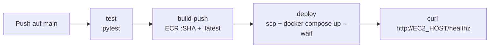

# Tag 14 – Container Teil 2: Deployment auf AWS (ECR + EC2)

## Einordnung im Unterricht

Tag 14 baut auf einer **bereits containerisierten** Anwendung auf: dem eigenen Projekt des Teams nach Tag 13 oder dieser Musterlösung `day_13_solution`. Das Classroom-Repository des Projektauftrags enthält den Stand von `day_13_solution`. Teams mit eigenem Projekt übernehmen ihren Stand mit den Befehlen aus der Tagesplanung (Weg A).

Neu sind nur drei Dateien und die Dokumentation:

| Datei | Zweck |
|-------|-------|
| [`.github/workflows/deploy-aws.yml`](../.github/workflows/deploy-aws.yml) | Pipeline: Tests → Build & Push nach ECR → Deployment auf EC2 → Smoke-Test |
| [`docker-compose.prod.yml`](../docker-compose.prod.yml) | Compose-Stack für den Server: Image aus ECR statt Build, Port 80 öffentlich |
| [`scripts/ec2-user-data.sh`](../scripts/ec2-user-data.sh) | User Data der EC2-Instanz: installiert Docker und Compose |
| [`DEPLOYMENT.md`](../DEPLOYMENT.md) | Architektur, Bedienungsanleitung, Rollback, Nachweise, Ausblick ECS |

Der Tag-13-Workflow [`container.yml`](../.github/workflows/container.yml) bleibt unverändert. Er veröffentlicht weiterhin in GHCR und läuft nur auf `day_13_solution`.

## Ablauf der Pipeline



1. **test** installiert `requirements-container.txt` und führt `pytest tests/` aus.
2. **build-push** meldet sich mit den Learner-Lab-Credentials (inklusive Session-Token) an, holt mit `amazon-ecr-login` die Registry-Adresse und pusht das Image als `techstyle:<commit-sha>` und `techstyle:latest`.
3. **deploy** schreibt den SSH-Schlüssel aus `EC2_SSH_KEY` auf den Runner, kopiert `docker-compose.prod.yml` als `~/techstyle/docker-compose.yml` und eine `.env` mit `TECHSTYLE_IMAGE`, `POSTGRES_PASSWORD` und `SECRET_KEY` auf den Server. Das ECR-Passwort holt der Runner und reicht es per SSH an `docker login` weiter. Die Instanz braucht dadurch keine eigenen AWS-Rechte. `docker compose up -d --wait` endet erst, wenn beide Healthchecks grün sind.
4. Der **Smoke-Test** ruft `/healthz` über die öffentliche IP auf und wiederholt den Aufruf bis zu 60 Sekunden lang.

Die Pipeline läuft bei jedem Push auf `main` und manuell über **Run workflow**. Auf `day_14_solution` startet sie nicht, weil hier keine AWS-Secrets hinterlegt sind.

## Vorbereitung in AWS

1. Learner Lab starten, unter **AWS Details** die drei CLI-Werte kopieren und `labsuser.pem` herunterladen.
2. ECR-Repository `techstyle` (privat) in `us-east-1` anlegen.
3. EC2-Instanz `techstyle-prod`: Ubuntu Server 24.04 LTS, `t3.small`, Key Pair `vockey`, SSH und HTTP erlauben, User Data aus `scripts/ec2-user-data.sh`.
4. Secrets im Repository setzen: `AWS_ACCESS_KEY_ID`, `AWS_SECRET_ACCESS_KEY`, `AWS_SESSION_TOKEN`, `EC2_HOST`, `EC2_SSH_KEY`, `POSTGRES_PASSWORD`, `SECRET_KEY`.

## Abnahmetests

```bash
# Automatische Kriterien
bash .github/classroom/grade.sh

# Nach einem grünen Lauf
curl -fsS http://<EC2_HOST>/healthz
aws ecr describe-images --repository-name techstyle --query 'imageDetails[].imageTags'

# Auf dem Server
ssh -i labsuser.pem ubuntu@<EC2_HOST> 'cd ~/techstyle && docker compose ps'
```

Manuell abgenommen werden: Shop im Browser erreichbar, zweite Änderung automatisch ausgerollt, Rollback über **Re-run all jobs** eines früheren Laufs.

## Fehlersuche

| Symptom | Ursache und Lösung |
|---------|--------------------|
| `build-push` scheitert bei *Configure AWS credentials* mit `ExpiredToken` oder `InvalidClientTokenId` | Lab-Session abgelaufen oder Session-Token fehlt. Die drei `AWS_*`-Secrets aus der aktuellen Session neu setzen. |
| `amazon-ecr-login` meldet `RepositoryNotFoundException` beim Push | ECR-Repository heisst nicht `techstyle` oder liegt in einer anderen Region. Name oder `ECR_REPOSITORY`/`AWS_REGION` im Workflow anpassen. |
| `deploy`: `Permission denied (publickey)` | `EC2_SSH_KEY` unvollständig. Den ganzen Inhalt von `labsuser.pem` inklusive `BEGIN`/`END`-Zeilen einfügen. Instanz mit Key Pair `vockey` erstellt? |
| `deploy`: `Connection timed out` | `EC2_HOST` veraltet (neue IP nach Lab-Neustart) oder Port 22 in der Security Group nicht offen. |
| `docker: command not found` oder `permission denied` auf dem Server | User Data noch nicht fertig oder nicht gesetzt. Zwei Minuten warten bzw. die Befehle aus `scripts/ec2-user-data.sh` per SSH mit `sudo` ausführen. |
| `up --wait` bricht ab, `web` unhealthy | `docker compose logs web` auf dem Server lesen. Häufig: `POSTGRES_PASSWORD` geändert, nachdem das Volume schon angelegt war. Passwort zurücksetzen oder einmalig `docker compose down --volumes` (löscht die Shopdaten). |
| Smoke-Test scheitert, Server läuft | Port 80 in der Security Group nicht offen. |

## Grenzen

Ein einzelner Server ohne Load Balancer: Während `docker compose up` ist der Shop wenige Sekunden nicht erreichbar. SSH ist für alle Adressen offen, weil die GitHub-Runner keine festen IPs haben. Statische Lab-Schlüssel statt OIDC-Rollen sind dem Learner Lab geschuldet. AWS ECS würde Verteilung, Healthchecks und Rolling Updates übernehmen; die Pipeline würde dann die Task Definition statt einer Compose-Datei aktualisieren.
