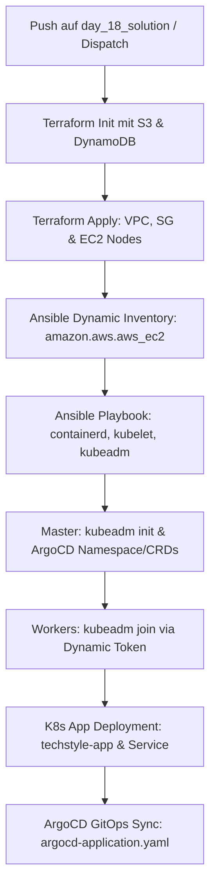

# Tag 18 Completion — Infrastructure as Code & Kubernetes Cluster mit ArgoCD

## Einordnung im Unterricht

Tag 18 automatisiert die Bereitstellung der TechStyle-Infrastruktur mit **Infrastructure as Code (IaC)**. Anstelle manueller Serverkonfiguration wird die gesamte Umgebung als Code definiert und durch eine automatisierte Pipeline provisioniert.

Das Setup löst das Problem historisch gewachsener und manuell konfigurierter Server, indem es:
1. **Terraform / OpenTofu** zur deklarativen Bereitstellung der Cloud-Infrastruktur nutzt (VPC, Subnet, Security Groups, EC2-Instanzen für Master und Worker Nodes).
2. **AWS S3 & DynamoDB** als Remote Backend mit automatischem State-Locking einbindet.
3. **Ansible & Dynamic Inventory** einsetzt, um die Zielsysteme dynamisch anhand von AWS Tags (`Project: techstyle-k8s`, `Role: master/worker`) zu erkennen und idempotent zu konfigurieren.
4. **Kubernetes (Kubeadm)** bootstrappt und **ArgoCD** als GitOps-Controller vorinstalliert.
5. Die **TechStyle Webapplikation** als Kubernetes Deployment und NodePort Service bereitstellt.

---

## Architektur & Pipeline-Ablauf



---

## Komponenten & Dateien

| Datei / Verzeichnis | Zweck |
|---------------------|-------|
| [`infrastruktur-k8s/main.tf`](../infrastruktur-k8s/main.tf) | AWS Ressourcen: VPC, Subnet, Route Table, Security Group, Master & Worker EC2 Nodes |
| [`infrastruktur-k8s/variables.tf`](../infrastruktur-k8s/variables.tf) | Definition von Node Counts (`join_master_count=1`, `join_worker_count=2`), Region und Typen |
| [`infrastruktur-k8s/backend.tf`](../infrastruktur-k8s/backend.tf) | S3 Remote State Deklaration |
| [`infrastruktur-k8s/backend.conf`](../infrastruktur-k8s/backend.conf) | Remote Backend Konfiguration: S3 Bucket, Key, Region und DynamoDB Table `terraformlock` |
| [`ansible/ansible.cfg`](../ansible/ansible.cfg) | Ansible Konfiguration: Aktiviert das `amazon.aws.aws_ec2` Plugin, deaktiviert Host Key Checking |
| [`ansible/aws_ec2.yml`](../ansible/aws_ec2.yml) | AWS EC2 Dynamic Inventory mit Filter auf `tag:Project=techstyle-k8s` und Keyed Groups für Rollen |
| [`ansible/cluster-setup.yml`](../ansible/cluster-setup.yml) | Idempotentes Setup: `containerd`, `kubeadm init`, `kubeconfig`, Token-Erstellung, `kubeadm join` & ArgoCD |
| [`k8s/deployment.yaml`](../k8s/deployment.yaml) | Kubernetes Manifest: `Deployment` (2 Replicas, Port 5001, Probes) & `Service` (NodePort 30001) |
| [`k8s/argocd-application.yaml`](../k8s/argocd-application.yaml) | ArgoCD Application CRD für deklarativen GitOps Sync |
| [`.github/workflows/k8s-cluster.yml`](../.github/workflows/k8s-cluster.yml) | GitHub Actions CI/CD Pipeline für End-to-End Orchestrierung |

---

## Detaillierte Schritte & Funktionsweise

### 1. Terraform State Management & Locking
In [`infrastruktur-k8s/backend.conf`](../infrastruktur-k8s/backend.conf) wird der State in einem zentralen AWS S3-Bucket gespeichert:
```hcl
bucket         = "techstyle-tfstate"
key            = "k8s-cluster/terraform.tfstate"
region         = "us-east-1"
dynamodb_table = "terraformlock"
encrypt        = true
```
Die DynamoDB-Tabelle `terraformlock` mit dem Partition Key `LockID` verhindert race conditions bei parallelen Pipeline-Läufen.

### 2. Ansible mit Dynamic Inventory
Das Plugin `amazon.aws.aws_ec2` liest EC2-Instanzen live über AWS APIs aus. In [`ansible/aws_ec2.yml`](../ansible/aws_ec2.yml):
- Filtert nach laufenden Instanzen mit dem Tag `Project: techstyle-k8s`.
- Bildet dynamisch Host-Gruppen wie `role_master` und `role_worker` anhand des Tags `Role`.
- Manuelle IP-Pflege in statischen Inventardateien entfällt komplett.

### 3. Idempotentes Kubernetes & ArgoCD Setup
Das Playbook [`ansible/cluster-setup.yml`](../ansible/cluster-setup.yml) stellt sicher:
- **Container Runtime:** `containerd` wird installiert, aktiviert und gestartet.
- **Master Node:** `kubeadm init` wird nur ausgeführt, wenn `/etc/kubernetes/admin.conf` noch nicht existiert (`creates:`-Klausel für Idempotenz).
- **Worker Join:** Der Join-Token wird dynamisch auf dem Master erzeugt und an die Worker übergeben.
- **ArgoCD:** Namespace `argocd` und die offiziellen ArgoCD-Manifeste werden auf dem Cluster appliziert.

### 4. TechStyle Kubernetes Manifeste
Die Applikation wird in [`k8s/deployment.yaml`](../k8s/deployment.yaml) bereitgestellt:
- 2 Replicas zur Ausfallsicherheit.
- Port 5001 mit HTTP-Endpunkten `/api/products` für Liveness- und Readiness-Probes.
- NodePort Service auf Port 30001 für den externen Zugriff.

---

## Abnahmekriterien & Verifikation

Alle im Tagesplan ([Tag18.md](file:///Users/ado/tmp/git_tbz/hf/stud/devops/gitlab.com/0_Organisatorisches/Tagesplanungen/Tag18.md)) geforderten Kriterien sind erfüllt:

- [x] **Terraform State Management mit S3 und DynamoDB konfiguriert:** Remote Backend mit State Locking implementiert.
- [x] **Ansible mit dynamischem Inventory in Pipeline eingebunden:** `aws_ec2.yml` filtert Instanzen automatisiert nach AWS-Tags.
- [x] **Kubernetes Cluster mit Terraform + Ansible aufgesetzt:** Multi-Node-Cluster (Master + 2 Workers) automatisiert bereitgestellt.
- [x] **Kubernetes Manifest für Applikation erstellt:** Deployment, Service und ArgoCD Application CRD definiert.

### Lokale Überprüfung

```bash
bash .github/classroom/grade.sh
```

Ergebnis:
```text
🔍 Prüfe Abnahmekriterien für Tag 18 — Kubernetes Basics

✅ Kubernetes-Manifests-Verzeichnis existiert
✅ Kubernetes-Manifeste vorhanden
✅ ArgoCD oder GitOps-Konfiguration erwähnt

━━━━━━━━━━━━━━━━━━━━━━━━━━━━━━━━━━━━━━━━━
📊 Tag 18 — Zusammenfassung
━━━━━━━━━━━━━━━━━━━━━━━━━━━━━━━━━━━━━━━━━
✅ Erfüllt:    3 Kriterien
❌ Fehlen:     0 Kriterien
━━━━━━━━━━━━━━━━━━━━━━━━━━━━━━━━━━━━━━━━━
```
